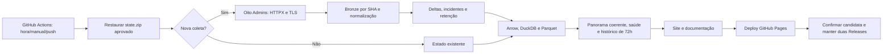

# Arquitetura do Admin Metrics

Revisão: 13/11/2026. Pacote 1.2.0; modelo das novas capturas 3; envelope de estado 1. Referência de código: `38a1faf`.

## Escopo e execução

O monitor consulta somente os oito `GET /open-banking/admin/v2/metrics` do [catálogo](../config/reporters.json). Os serviços de clientes/pagamentos descritos no corpo são evidência, nunca alvos de requisições. As fontes são reportes operacionais; CNPJ ou host não atesta controle societário. Nissan e Renault permanecem identidades distintas.

Python executa no runner temporário do GitHub Actions. HTTPX/truststore fazem a captura com TLS verificado; Arrow tipa os dados; DuckDB calcula os marts; Parquet Zstandard permite reutilização analítica. HTML/CSS/JavaScript/SVG servem o painel sem servidor analítico, CDN, fontes externas ou acesso bancário pelo navegador.

## Módulos e fronteiras

| Arquivo | Responsabilidade |
|---|---|
| [collect.py](../src/admin_metrics/collect.py) | Captura, paginação, retry HTTP/transporte, recaptura de vazio e bronze |
| [contracts.py](../src/admin_metrics/contracts.py) | Validação das URIs declaradas sem chamá-las |
| [rules.py](../src/admin_metrics/rules.py) | Tipos, limites e relações entre parâmetros; cron informativo |
| [analysis.py](../src/admin_metrics/analysis.py) | Nulos, dia analítico, comparabilidade por contador, incidentes e poda |
| [health.py](../src/admin_metrics/health.py) | Resultado da fonte e saúde da última tentativa |
| [panorama.py](../src/admin_metrics/panorama.py) | Último ciclo completo e dia comum por recorte |
| [storage.py](../src/admin_metrics/storage.py) | Hash, arquivo atômico, estado e lock de escritor |
| [archive.py](../src/admin_metrics/archive.py) | Pack/restore com os mesmos limites e verificações |
| [build.py](../src/admin_metrics/build.py) / [marts.sql](../src/admin_metrics/marts.sql) | Warehouse, cinco Parquets e payload estático |
| [pipeline.py](../src/admin_metrics/pipeline.py) | Transação local de aplicação, geração e avanço do estado |
| [cloud_pipeline.py](../scripts/cloud_pipeline.py) | Release aprovada, candidata draft, deploy comprovado, recibo e rotação |
| [web](../src/admin_metrics/web) | Filtros, panorama, monitor, gráficos, detalhes e CSV |
| [documentation.py](../src/admin_metrics/documentation.py) | Geração do manual HTML a partir do código e estado |

## Persistência e consumo

| Camada | Persistência / duração |
|---|---|
| Releases `state-*` | Dois pacotes aprovados: atual e anterior. Cada pacote contém todo o histórico normalizado retido e bronze de dois ciclos |
| `state.json` | Runs, observações, incidentes e últimas linhas boas. Janela de 30 dias aplicada após coleta |
| `bronze/<sha>.json` | Corpos completos por hash; referências dos dois ciclos recentes por pacote |
| `data/gold/warehouse.duckdb` | Derivado reconstruído localmente/no runner; não é banco remoto persistente |
| Cinco Parquets | `current_rows`, `observations`, `report_summary`, `family_summary`, `observation_trends` |
| Pages | `index.html`, `dashboard.json`, manual e assets imutáveis. Séries e monitor de 72h; panorama pode recorrer a um ciclo anterior ainda retido |

Dois pacotes não significam duas observações: o pacote atual carrega até 30 dias. A união dos bronzes de atual/anterior pode abranger três ciclos. Os bytes antigos podem expirar embora os hashes continuem nas observações.

## Continuidade e qualidade

Saúde da coleta e sucesso da publicação são independentes. Uma resposta vazia/503 é um dado operacional; o pipeline a registra e publica diagnóstico. Corrupção, referências inválidas, configuração inválida ou falha de build são bloqueantes.

O panorama não agrega silenciosamente `latest_rows` de ciclos diferentes. Para cada recorte (`all` ou uma fonte), busca em `observations` o último run com todas as fontes exigidas utilizáveis, contagens conciliadas e um único `day`. O dia vem do `HTTP Date` da página que produziu cada linha; uma captura cujas páginas cruzam o dia fica incompleta. Se a coleta atual é parcial ou cruza dias de referência incompatíveis, preserva o ciclo anterior. Sem ciclo válido na retenção, informa indisponibilidade. A preservação não cria pontos ou timestamps novos.

## Publicação e integridade

1. Restaurar a última Release aprovada, com checksum externo, manifesto, hashes, nomes/limites, `purpose`/IDs e assets esperados validados; falha de escrita antes do ponteiro final remove os bronzes daquela tentativa.
2. Sob lock `.writer.lock`, coletar/aplicar quando solicitado, validar o estado e gerar os artefatos.
3. Gravar `state.json` apenas depois de concluir o build; validar envelope/modelo conhecido e remover localmente somente bronzes de nomes SHA válidos fora dos dois últimos ciclos.
4. Em coleta nova, criar candidata draft com ZIP, checksum e identidade do run.
5. Publicar um artefato Pages completo. Assets ficam em `assets/<hash>/`; a URL de entrada continua na raiz.
6. `promote` exige job `deploy` concluído com sucesso no workflow correspondente, grava recibo, publica a Release e remove aprovadas além das duas recentes.

O grupo de concorrência `admin-state-and-pages` é compartilhado por push/manual/schedule, com `cancel-in-progress: false`. Pages e Releases não têm transação distribuída: deploy pode concluir e promoção falhar; o [runbook](operacao.md) descreve a reconciliação.

## Limites

Um escritor por estado, processamento single node e amostragem periódica. Sem SSO, RBAC, alertas externos, execução contínua ou garantia de pontualidade. O aviso de idade usa o relógio do navegador. O monitor só muda após publicação; jobs em andamento são consultados no Actions. Dados de serviços são autodeclarados, sem comprovação causal ou regulatória.
