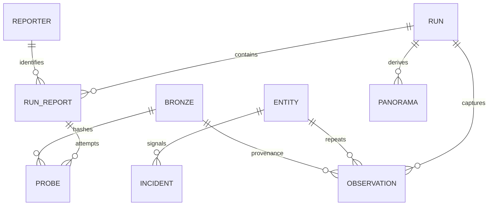

# Contratos, modelo e regras

Revisão: 13/11/2026; implementação 1.2.0. Fontes autoritativas: [catálogo](../config/reporters.json), [regras](../config/rules.json), [normalizador](../src/admin_metrics/analysis.py), [saúde](../src/admin_metrics/health.py), [panorama](../src/admin_metrics/panorama.py) e [SQL](../src/admin_metrics/marts.sql).

## Entrada e captura

O GET usa `page=N&page-size=1000&period=ALL`. O corpo esperado contém `data[]` e metadata de totais; cada identidade vem de `endpoint`. O [contrato Admin 2.0.1](https://raw.githubusercontent.com/OpenBanking-Brasil/openapi/main/swagger-apis/admin/2.0.1.yml) distingue métricas atuais dos arrays `previousDays`. Não se deduz conformidade integral da conciliação observacional de registros.

| Limite | Valor implementado |
|---|---:|
| Capturas concorrentes | 4 |
| Timeout por operação HTTP | 20 s |
| Páginas por captura/fonte | 20 |
| Corpo por resposta, após descompressão | 16 MiB |
| Identidades por fonte | 10.000; ao atingir o teto, a captura fica incompleta e registra `record_limit` |
| Tentativas HTTP por página | Até 3 |
| Retry-After / espera HTTP | Até 15 s |
| Recapturas após vazio de fonte antes válida | Até 2; esperas configuradas de 10 s e 30 s |

Retry HTTP/transporte cobre transporte e HTTP 408/429/500/502/503/504/529. Leitura interrompida após cabeçalho HTTP 200 também pode repetir. HTTP 403 não é contornado. Não há redirects nem TLS desativado. Esperar uma recaptura vazia libera a vaga de concorrência. Cada recaptura tem seu próprio orçamento HTTP; não confundir duas recapturas com limite global de três requisições por ciclo.

Duplicata idêntica não soma métricas. Conflito de valores para a mesma identidade preserva a primeira como evidência, marca a captura incompleta e impede seu uso nos KPIs atuais. URI inválida é isolada como qualidade da fonte; não interrompe as demais.

## Grãos e relações

Essas são relações lógicas do JSON; não são todas constraints SQL. `entity_id=SHA256([reporter_id, endpoint])[:24]`. O catálogo usa `id`; as linhas analíticas usam `reporter_id`. Mudança de rótulo não muda a identidade.

| Estrutura | Grão / conteúdo |
|---|---|
| `state.version` | Envelope 1; independente do pacote 1.2.0 e do `model_version` |
| `runs[]` | `run_id`, início UTC, `reports`, regras usadas, modelo e, quando disponível, `execution_url` |
| `runs[].reports[]` | Fonte/run: HTTP final, registros, cobertura, usabilidade, issues e probes |
| `probes[]` | Fonte/run/captura/página/tentativa HTTP: instante, URL, HTTP, duração, bytes, erro, Date e SHA |
| `observations[]` | Run × entidade: métricas, contexto, qualidade, arrays anteriores e deltas |
| `latest_rows[]` | Última captura completa/não vazia da fonte; contexto parcial inicial somente quando nunca existiu boa |
| `incidents[]` | Ocorrência por entidade/regra: abertura, detecções, severidade, recuperação e evidência |
| `reported_history[]` | Projeção D−1 a D−3 do último contexto por endpoint; não é coleta própria |
| `points[]` | Projeção das observações próprias na janela de 72h; não copia métricas antigas para runs vazios |
| `panoramas[all ou reporter_id]` | Derivado: `run_id`, `observed_at`, `day`, `rows`; um ciclo completo e um dia por recorte |
| `collection_health` | Resultado atual, fontes válidas/total, última tentativa e último panorama válido; `sources[]` detalha por fonte |

### Cobertura, usabilidade e saúde

| Campo | Significado |
|---|---|
| `report.status` / `probe.status` | Número HTTP; 0 quando não houve resposta HTTP |
| `coverage_reconciled` | Quantidade única recebida coincide com o total declarado; não atesta métricas utilizáveis |
| `complete` / `usable` | Nova captura não vazia, conciliada e sem conflitos/endpoint inválido; não garante validade de todos os campos |
| `data_status` | `valid`, `empty`, `http_error`, `transport_error`, `invalid_report` |
| `empty_retry_count` | Número de recapturas após vazio; não conta retry HTTP interno |
| `probe.capture_attempt` | Número da captura; `probe.attempt` é a tentativa HTTP na página |
| `probe.data_status=received` | Corpo de uma página intermediária recebido; resultado global da fonte ainda não concluído |
| `collection_health.status` | `healthy` se todas as fontes são utilizáveis; `partial` se algumas; `unavailable` se nenhuma |
| `collection_health.sources[].status` | Enum de resultado da fonte, não número HTTP |

HTTP 200 + `data=[]` + `totalRecords=0` resulta, nas novas capturas, em `coverage_reconciled=true`, `complete=false`, `usable=false`, `data_status=empty`. Falha HTTP com corpo de erro não é resposta vazia de métricas. Quando a normalização descarta registros inválidos, `coverage_reconciled` passa a `false`; quando as páginas cruzam o dia de referência, a cobertura fica `mixed_reference_day`, a captura fica incompleta e cada linha recebe `page_day_changed`. Modelos antigos são interpretados de modo compatível; não são recalculados retroativamente.

## Métricas normalizadas

| Entrada atual | Coluna |
|---|---|
| `invocations.currentDay` | `calls` |
| `errors.currentDay` | `errors` |
| `rejections.currentDay` | `rejections` |
| `averageResponse.currentDay` | `mean_ms` |
| `averageTps.currentDay` | `average_tps` |
| `peakTps.currentDay` | `peak_tps` |

Esses campos exigem inteiros int64 não negativos; booleanos e valores incompatíveis ficam nulos com flags. Uptime é convertido para razão finita em [0,1]; booleanos, `NaN`/`Infinity` e valores fora do intervalo ficam nulos. Downtime permanece em segundos. `request_time`, `source_sha`, `json_path` e `clock_offset_seconds` preservam proveniência. `fresh` significa mesmo run da última tentativa, não dados recentes pelo relógio.

Dia analítico: HTTP Date da página que produziu a linha, convertido para America/Sao_Paulo; fallback para o instante da coleta. Se páginas do mesmo reporte cruzam o dia, a captura é incompleta e sinalizada. Essa convenção não comprova o fuso de consolidação do banco. Divergência de `requestTime` é sinalizada, sem correção silenciosa.

## Fórmulas e comparabilidade

- Erro: `100 × errors/calls`; rejeição: `100 × rejections/calls`. Exigem chamadas positivas e numerador válido ≤ chamadas. Cada agregado usa o seu denominador válido.
- Média ponderada: `Σ(mean_ms × calls)/Σ(calls)`, somente com média e chamadas positivas. Não é p95.
- Baseline: mediana das médias positivas nos arrays anteriores, com quantidade mínima configurada. Recorrência conta posições com amostra e erro acima dos limiares; pode considerar até sete dias, mesmo quando o detalhe mostra três.
- Não somar cumulativos entre runs nem arrays anteriores repetidos. Comparação intervalar exige entidade/dia iguais e dados comparáveis.

`interval_state` pode ser `first_observation`, `observation_time_not_increasing`, `day_changed`, `incomplete_source`, `unchanged_report`, `invalid_counter`, `counter_reset_or_revision`, `inconsistent_delta` ou `valid`. Deltas indisponíveis ficam nulos; delta de chamadas zero não produz taxa. Não se infere média intervalar.

`interval_error_state` e `interval_rejection_state` avaliam os numeradores separadamente. Reset somente em rejeições não oculta regra válida de erro. Latência/regressão continuam avaliáveis quando suas próprias métricas e amostra são válidas. Tempo não crescente impede a avaliação de serviço; ausência/baixa amostra/métrica inválida não comprova recuperação.

## Configuração vigente

Os valores são os de [config/rules.json](../config/rules.json); tipos, finitude, limites e relações entre limiares são validados antes de coletar. O catálogo [config/reporters.json](../config/reporters.json) exige `id`, `label`, `company`, `cnpj` de 14 dígitos e URL Admin válida, além de IDs únicos. O envelope de estado é versão 1; `model_version` aceita modelos conhecidos (1, 2 e 3) e um valor desconhecido bloqueia pack/restore.

| Parâmetro | Valor |
|---|---:|
| `retention_days` | `30` |
| `dashboard_history_days` | `3` |
| `schedule_interval_hours` | `1` |
| `schedule_minute` | `17` |
| `error_attention_pct` | `5` |
| `error_critical_pct` | `20` |
| `minimum_calls` | `100` |
| `critical_minimum_calls` | `1000` |
| `rejection_attention_pct` | `5` |
| `latency_attention_ms` | `2000` |
| `latency_critical_ms` | `4000` |
| `regression_multiplier` | `2` |
| `recovery_samples` | `2` |
| `confirmation_samples` | `2` |
| `baseline_minimum_days` | `3` |
| `recurrent_minimum_days` | `3` |
| `reported_history_days` | `7` |
| `clock_skew_seconds` | `900` |
| `stale_after_hours` | `2` |
| `chart_gap_hours` | `1.5` |
| `empty_retry_delays_seconds` | `[10, 30]` |

Erro acima do limiar de atenção abre sinal; crítico também exige a amostra crítica. Rejeição e regressão são sinais de atenção. Latência usa os dois limiares de ms. Coleta é atenção na primeira falha e crítica após `confirmation_samples` falhas consecutivas.

Uma ocorrência é confirmada após a sequência configurada. Duas detecções não provam novos erros entre ciclos. Recuperação exige `recovery_samples` avaliações consecutivas abaixo do limiar; desconhecimento interrompe a sequência. Resolução posterior seguida de nova detecção cria outra ocorrência.

## Warehouse e retenção

O contrato Arrow de `current_rows`/`observations` tem 18 campos: nove strings (`run_id`, `entity_id`, `observed_at`, `day`, `reporter_id`, `reporter`, `endpoint`, `path`, `family`), quatro int64 (`calls`, `errors`, `rejections`, `mean_ms`), três doubles (`error_pct`, `rejection_pct`, `uptime`) e dois booleanos (`source_complete`, `fresh`). O JSON contém campos adicionais; não são contratos idênticos.

`report_summary` e `family_summary` usam somente linhas completas do run atual. `observation_trends` agrega por run/instante/fonte. O panorama preservado é derivado separado; não altera os marts atuais. As cinco tabelas são exportadas em Parquet.

Poda por ciclos completos aos 30 dias preserva referências entre runs e observações. Resolvidos ficam 30 dias; incidentes abertos não expiram automaticamente. O run de abertura pode ter expirado. O pacote atual/anterior tem apenas bronze dos dois ciclos recentes. Pack e restore compartilham limites: ZIP 300 MiB, expansão total 512 MiB, `state.json` 512 MiB, demais entradas 16 MiB e 4.096 entradas. O limite total também se aplica ao somar estado e bronze.
