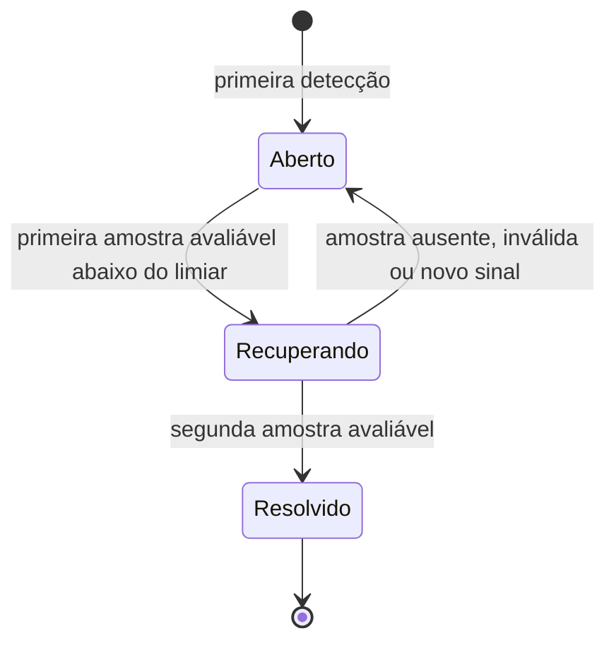

## Resumo executivo

O **Admin Metrics** é um observatório executivo dos oito reportes Admin do Santander no Open Finance. A cada hora, ele consulta somente o endpoint público `GET /open-banking/admin/v2/metrics` de cada reporte, preserva a resposta original, normaliza as métricas declaradas, calcula taxas e incidentes com regras versionadas e publica um dashboard estático e um conjunto de artefatos analíticos.

O produto atende três leituras do mesmo fato: **negócio** (onde investigar e o que o número significa), **técnica** (como o dado foi capturado, transformado e modelado) e **operação** (como executar, publicar e recuperar). O documento descreve o estado implementado no repositório, não uma promessa de roadmap.

<div class="cards">
<div class="card"><h3>Para quem decide</h3><p>Panorama executivo, ranking de erros, incidentes explicáveis e leitura de cobertura para priorizar investigação sem confundir ausência de dado com zero.</p></div>
<div class="card"><h3>Para quem analisa</h3><p>Dashboard filtrável, detalhe por endpoint, série de 72 horas, histórico declarado pelo banco, exportação CSV e receitas SQL sobre Parquet.</p></div>
<div class="card"><h3>Para quem opera</h3><p>Coleta horária no GitHub Actions, estado com lock de escritor, pacotes de recuperação com checksum, retenção de 30 dias e runbook de restauração.</p></div>
</div>

- **Origens:** oito hosts oficiais em `config/reporters.json`; nenhum endpoint de cliente ou pagamento é chamado.
- **Cadência:** cron `17 * * * *` UTC; o dashboard publica os últimos 3 dias e o estado normalizado retém 30 dias.
- **Entrega:** dashboard em GitHub Pages, `site/dashboard.json`, cinco arquivos Parquet em `data/gold/` e um manual HTML autocontido.
- **Limite central:** as métricas são **autodeclaradas** pelo banco. Média declarada não é p95; erro não identifica status HTTP; rejeição não prova causa; o monitor não é laudo de conformidade regulatória.

> Atenção: o snapshot local de implementação disponível em 10/11/2026 contém oito reportes com HTTP 200 e 276 identidades; o reporte Santander principal declarou páginas excedentes mesmo cobrindo o total de registros, e a divergência de aproximadamente três horas em `requestTime` permanece sinalizada. Esse snapshot não é telemetria ao vivo.

A leitura recomendada começa em [escopo funcional e origens](#escopo-funcional), passa por [como usar o dashboard](#dashboard) e [regras de negócio](#regras-negocio), e só então avança para [arquitetura](#arquitetura), [modelo de dados](#modelo-dados) e [operação](#operacao).

## Escopo funcional e origens

O monitor cobre o **Admin API** do Open Finance brasileiro. A coleta é deliberadamente estreita: o catálogo valida esquema, host, porta, caminho e ausência de parâmetros livres antes de qualquer requisição. O único caminho permitido é `/open-banking/admin/v2/metrics` no host `<reporter_id>.api.santander.com.br`.

<div class="cards">
<div class="card"><h3>Entra</h3><p>Respostas JSON paginadas dos oito reportes Admin, com métricas declaradas por endpoint e o cabeçalho HTTP `Date` de cada página.</p></div>
<div class="card"><h3>Sai</h3><p>Dashboard, payload JSON, Parquet tipado, estado de 30 dias, incidentes e pacotes ZIP de recuperação aprovados.</p></div>
<div class="card"><h3>Fica fora</h3><p>Serviços de clientes, pagamentos, consentimentos e qualquer URL descrita dentro do relatório. Também ficam fora autenticação corporativa e julgamento regulatório.</p></div>
</div>

### Catálogo de reportes

| `reporter_id` | Rótulo operacional | Empresa no catálogo | CNPJ | Host Admin |
|---|---|---|---|---|
| `ccvm` | Santander CCVM | SANTANDER CCVM S.A. | `51014223000149` | `ccvm.api.santander.com.br` |
| `financiamentos` | Aymoré | AYMORE CFI S.A. | `07707650000110` | `financiamentos.api.santander.com.br` |
| `getnet` | Getnet | GETNET ADQUIRENCIA E SERVICOS PARA MEIOS DE PAGAMENTO S A | `10440482000154` | `getnet.api.santander.com.br` |
| `hyundai` | Hyundai Capital | BANCO HYUNDAI CAPITAL BRASIL | `30172491000119` | `hyundai.api.santander.com.br` |
| `nissan` | RCI · Nissan | BCO RCI BRASIL S.A. | `62307848000115` | `nissan.api.santander.com.br` |
| `openbanking` | Santander | BCO SANTANDER (BRASIL) S.A. | `90400888000142` | `openbanking.api.santander.com.br` |
| `renault` | RCI · Renault | BCO RCI BRASIL S.A. | `62307848000115` | `renault.api.santander.com.br` |
| `toro` | Toro | Santander CTVM S.A. | `29162769000198` | `toro.api.santander.com.br` |

> Atenção: Nissan e Renault compartilham o mesmo CNPJ, mas permanecem fontes distintas por `reporter_id` e por host. O vínculo de URL e CNPJ foi conferido no Diretório oficial; ele não comprova controle societário nem substitui a identidade operacional do reporte.

### Contrato consumido

| Elemento | Uso no monitor |
|---|---|
| `GET /open-banking/admin/v2/metrics` | Única rota permitida; `https`, host exato, porta 443 ou ausente, sem usuário, query ou fragmento. |
| `page` | Página solicitada, começando em 1; o monitor limita a 20 páginas por captura. |
| `page-size=1000` | Tamanho de página fixo na requisição. |
| `period=ALL` | Período solicitado ao Admin. |
| `meta.totalRecords` / `meta.totalPages` | Usados para conciliar cobertura; metadados divergentes geram diagnóstico, não correção silenciosa. |
| `data[].endpoint` | Identidade declarada do serviço; é validada como URI, mas **nunca chamada**. |
| `data[].requestTime` | Horário declarado pelo banco; preservado e comparado com a aquisição, sem correção automática de fuso. |
| `invocations`, `errors`, `rejections` | Contadores cumulativos do dia, em `currentDay`, com `previousDays` declarados. |
| `averageResponse`, `averageTps`, `peakTps` | Médias e picos declarados; a resposta média não é p95. |
| `availability.uptime` / `availability.downtime` | Uptime, downtime parcial, downtime geral e parada programada declarados. |

O catálogo também mantém `config/catalog-evidence.json`, com a data de verificação, o hash do Diretório e os matches de URL/CNPJ. A presença do comprovante não transforma o monitor em auditoria: ele documenta de onde veio a lista de hosts.

> Limitação: o monitor não mede a disponibilidade dos serviços de clientes descritos no relatório. Ele mede a resposta do **Admin** e reproduz as médias que o próprio banco declara. Uma falha de acesso ao Admin não prova indisponibilidade dos demais serviços.

## Como usar o dashboard

A home publica dois manuais: `documentacao.html`, gerado pela aplicação, e `docs_v2/documentacao-v2.html`, este manual. Ambos são autocontidos e podem ser abertos sem servidor. O dashboard exige a pasta `site/` completa porque usa `assets/`, `data.js`, `styles.css` e `app.js`.

<div class="cards">
<div class="card"><h3>Triagem em três passos</h3><p>Leia o aviso de atualização, confira o panorama e abra os incidentes. Só depois desça ao endpoint e ao histórico declarado.</p></div>
<div class="card"><h3>Um recorte por vez</h3><p>O seletor de reporte é global. Ele muda panorama, incidentes, tendências, endpoints, saúde, monitor e qualidade, sem misturar ciclos.</p></div>
<div class="card"><h3>Evidência antes da conclusão</h3><p>Clique no endpoint para ver deltas, flags, SHA, caminho JSON e os dias anteriores declarados. Exporte o CSV do recorte filtrado.</p></div>
</div>

### Seções da home

| Seção | Pergunta que responde | Principais controles |
|---|---|---|
| 01 · Panorama executivo | O que exige atenção agora? | Reporte global, cartões de KPI, ranking de erros, cartões por fonte. |
| 02 · Incidentes | O que está aberto, em recuperação ou resolvido? | Estado: ativos, todos ou somente críticos. |
| 03 · Tendências | Como a métrica evoluiu nas nossas observações? | Métrica: erro, média declarada ou chamadas; janela fixa de 72 h. |
| 04 · Endpoints | Qual serviço reportado concentra o problema? | Busca sem acento, família, ordenação, paginação de 25 linhas. |
| 05 · Saúde da coleta | O que o observador conseguiu medir? | Última tentativa por fonte, HTTP, cobertura, duração e diagnóstico. |
| 06 · Monitor de execuções | Como cada API respondeu em cada extração? | Matriz extração × API, 12 execuções por página, detalhe de tentativas. |
| 07 · Qualidade do reporte | Quais inconsistências mudam a interpretação? | Contagem de flags por endpoint e estados de intervalo. |
| 08 · Metodologia | Quais critérios e limites estão em vigor? | Resumo das regras configuradas e links para as fontes oficiais. |

### Fluxo de leitura recomendado

1. **Confira a idade real do dado.** O aviso separa “última tentativa” de “últimos dados válidos do panorama”. Uma tentativa recente com resposta vazia não renova a idade do dado.
2. **Leia o contexto do panorama.** `CICLO ATUAL` indica que o panorama usa o último ciclo; `DADOS ANTERIORES` indica preservação explícita de um ciclo completo anterior; `SEM PANORAMA VÁLIDO` indica que não há ciclo completo e com um único dia de referência para o recorte.
3. **Priorize incidentes confirmados.** O primeiro sinal é provisório. “Persistência confirmada” significa que a sequência atingiu duas detecções; não prova que surgiram novos erros entre as coletas.
4. **Investigue o endpoint.** O detalhe mostra a comparação com a observação anterior, a série própria de 72 h, os dias D−1 a D−3 declarados pelo banco, a qualidade e a proveniência.
5. **Exporte somente o necessário.** O CSV contém as linhas visíveis no filtro atual, com 23 colunas e proteção contra fórmulas de planilha.

### Matriz de interpretação da home

| Situação exibida | Condição implementada | Leitura correta |
|---|---|---|
| `CICLO ATUAL` | O panorama selecionado é do último run e cobre o recorte com um único dia. | Os KPIs vêm de um ciclo completo atual. |
| `DADOS ANTERIORES` | O último run não renovou o panorama, mas há um ciclo completo anterior. | Os valores são reais, porém antigos; a saúde da coleta continua sendo a da última tentativa. |
| `SEM PANORAMA VÁLIDO` | Nenhum ciclo completo atende ao recorte e ao dia comum. | Métricas ausentes permanecem indisponíveis; não são convertidas em zero. |
| `HTTP 200 sem dados` | Resposta vazia conciliada, sem métricas utilizáveis. | O Admin respondeu; isso não é sucesso de coleta nem renovação de KPI. |
| `Falha HTTP` | Status diferente de 200 após o retry permitido. | O diagnóstico é da nossa tentativa ao Admin, não dos serviços descritos. |
| `Reset ou revisão` | O contador cumulativo diminuiu entre observações comparáveis. | O delta do contador fica indisponível; a latência válida pode continuar sendo avaliada. |
| `Reporte sem mudança` | O fingerprint das métricas é igual ao da observação anterior. | Não se infere tráfego novo nem taxa de chegada. |
| `Origem incompleta` | Cobertura não conciliada, conflito de identidade ou página cruzando o dia. | A linha pode aparecer como contexto, mas não alimenta KPIs e marts do ciclo. |

> Exemplo prático: às 14h o panorama está completo. Às 15h, uma fonte responde HTTP 200 com corpo vazio. O dashboard mostra “0/8 fontes com dados válidos nesta tentativa” ou o número correspondente, mas mantém o panorama das 14h com a etiqueta **DADOS ANTERIORES**. Os KPIs não viram zero; a saúde da coleta denuncia a tentativa vazia.

> Atenção: o filtro global de reporte altera a visão, mas não reescreve o estado. O CSV exporta apenas as linhas visíveis; links profundos usam `?reporter=`, `?q=`, `?family=` e `?sort=` para reproduzir o recorte.

## Regras de negócio e triagem

As regras separam **exibição** de **sinal**. O dashboard mostra taxas sempre que há numerador e denominador válidos; o incidente só é aberto quando a regra configurada é elegível. Um percentual alto com amostra pequena aparece no detalhe, mas não necessariamente vira incidente.

<div class="cards">
<div class="card"><h3>Denominador importa</h3><p>Erro e rejeição usam seus próprios denominadores válidos. Uma linha com erro maior que chamadas é excluída do numerador e do denominador daquela taxa.</p></div>
<div class="card"><h3>Média não é p95</h3><p>A média ponderada é Σ(média × chamadas) ÷ Σ(chamadas), apenas para linhas com média positiva e chamadas positivas. Nenhum percentil é inferido.</p></div>
<div class="card"><h3>Persistência não é causa</h3><p>Duas detecções confirmam persistência. O monitor não identifica status HTTP de erro, causa de rejeição ou relação causal entre reportes.</p></div>
</div>

### Fórmulas e elegibilidade

- Taxa de erro: `error_pct = 100 × errors ÷ calls`, somente quando `calls > 0` e `0 ≤ errors ≤ calls`.
- Taxa de rejeição: `rejection_pct = 100 × rejections ÷ calls`, sob os mesmos critérios.
- Média ponderada: `Σ(mean_ms × calls) ÷ Σ(calls)`, somente com `mean_ms > 0` e `calls > 0`.
- Baseline: mediana das médias diárias anteriores positivas, exigindo pelo menos `baseline_minimum_days` = 3 valores.
- Regressão: `mean_ms ≥ regression_multiplier × baseline_mean_ms`, com `regression_multiplier` = 2.
- Recorrência: contagem de dias anteriores com `calls ≥ minimum_calls` = 100 e `error_pct ≥ error_attention_pct` = 5%, considerando até 7 dias declarados.

### Limiares configurados

| Regra | Condição de atenção | Condição crítica | Amostra mínima |
|---|---|---|---|
| Taxa de erro | `error_pct ≥ 5%` | `error_pct ≥ 20%` e `calls ≥ 1.000` | 100 chamadas |
| Taxa de rejeição | `rejection_pct ≥ 5%` | Sem nível crítico próprio | 100 chamadas |
| Média declarada | `mean_ms ≥ 2.000` | `mean_ms ≥ 4.000` | 100 chamadas |
| Regressão de média | `mean_ms ≥ 2 ×` mediana de 3 médias anteriores | Sem nível crítico próprio | 100 chamadas e 3 médias positivas |
| Recorrência contextual | 3 dias anteriores com erro ≥ 5% e ≥ 100 chamadas | Não se aplica | Até 7 dias declarados |
| Falha de coleta | Primeira falha consecutiva | Segunda falha consecutiva | Um reporte por ciclo |
| Recuperação | 2 amostras avaliáveis consecutivas abaixo do limiar | Não se aplica | Regra precisa estar elegível |

```chart
{"type":"bar","title":"Limiares configurados de erro e rejeição","unit":"%","source":"config/rules.json","asOf":"15/11/2026","data":[{"label":"Erro · atenção (mín. 100 chamadas)","value":5,"variant":"warning"},{"label":"Erro · crítico (mín. 1.000 chamadas)","value":20,"variant":"danger"},{"label":"Rejeição · atenção (mín. 100 chamadas)","value":5,"variant":"warning"}]}
```

```chart
{"type":"bar","title":"Limiares configurados de latência média","unit":"ms","source":"config/rules.json","asOf":"15/11/2026","data":[{"label":"Atenção · 2.000 ms","value":2000,"variant":"warning"},{"label":"Crítico · 4.000 ms","value":4000,"variant":"danger"}]}
```

> Regra de negócio: o nível crítico de erro exige **as duas condições**: pelo menos 1.000 chamadas e pelo menos 20% de erro. Um endpoint com 500 chamadas e 30% de erro gera atenção, não crítico. A latência crítica exige pelo menos 100 chamadas e 4.000 ms.

> Regra de negócio: a recorrência contextual é um indicador de leitura exibido no painel e no detalhe; ela não abre um incidente próprio. As regras que abrem ocorrência são erro, rejeição, latência, regressão de latência e falha de coleta.

### Exemplos numéricos

> Exemplo prático: um endpoint declara 80 chamadas e 10 erros. A taxa exibida é 12,5%, mas a amostra é inferior a 100 chamadas; a regra de erro não é elegível e não abre incidente por esse critério.

> Exemplo prático: 2.000 chamadas e 150 erros resultam em 7,5%. Há atenção (≥ 5% e ≥ 100 chamadas), mas não crítico, porque 7,5% < 20%.

> Exemplo prático: 1.500 chamadas e 330 erros resultam em 22,0%. Há crítico, porque 22,0% ≥ 20% e 1.500 ≥ 1.000. O incidente nasce como atenção e passa a crítico na mesma detecção se a sequência já estiver confirmada.

> Exemplo prático: 120 chamadas e 8 rejeições resultam em 6,67%. Há atenção por rejeição, mas o monitor não afirma que a causa seja 429, fraude, contrato ou indisponibilidade.

> Exemplo prático: as médias anteriores positivas são 200 ms, 300 ms e 400 ms; a mediana é 300 ms. Uma média atual de 650 ms é 2,17× a baseline e gera atenção por regressão, desde que haja pelo menos 100 chamadas.

> Exemplo prático: um incidente de erro está aberto. A primeira amostra avaliável abaixo do limiar o coloca em recuperação; a segunda o resolve. Uma amostra ausente, inválida, parcial ou de baixa amostra zera a sequência de recuperação e mantém o incidente aberto.

### Matriz de decisão

| Condição | Resultado | Leitura |
|---|---|---|
| `calls < 100` | Nenhuma regra de erro, rejeição, latência ou regressão é elegível | O número pode aparecer no dashboard, mas não vira incidente. |
| `error_pct ≥ 5%` e `calls ≥ 100` | Atenção | Investigue o endpoint e o contexto; não presuma causa. |
| `error_pct ≥ 20%` e `calls ≥ 1.000` | Crítico | Prioridade alta, com evidência de numerador e denominador. |
| `rejection_pct ≥ 5%` e `calls ≥ 100` | Atenção | Rejeição é sinal, não diagnóstico de causa. |
| `mean_ms ≥ 2.000` e `calls ≥ 100` | Atenção ou crítico conforme 4.000 ms | Média declarada, não p95. |
| Reset de contador | Regras de contador suspensas; latência válida continua | Não se compara contador revisado. |
| Cobertura incompleta | Regras suspensas naquela linha | Ausência de sinal não é recuperação. |

> Limitação: os limiares são critérios analíticos do monitor. Eles não são limites regulatórios, SLA contratual ou laudo de conformidade. A calibração pode ser alterada em `config/rules.json`, desde que a validação de ordem e faixa aceite o conjunto.

## Arquitetura da solução

A solução é um pipeline batch horário com publicação estática. Não há servidor de aplicação, banco relacional nem consulta ao vivo no navegador: o GitHub Actions coleta, o Python normaliza e agrega, o DuckDB materializa Parquet, e o Pages entrega HTML, CSS, JavaScript e JSON estáticos.

```solution
{
  "title": "Arquitetura em estágios 2D — captura, análise e publicação",
  "cols": 4,
  "colWidth": 218,
  "colGap": 50,
  "inputs": { "label": "ENTRADAS E CONTROLE" },
  "zones": [
    {
      "id": "ingest",
      "title": "ESTÁGIO 1 · INGESTÃO",
      "subtitle": "a cada hora, com retry limitado",
      "variant": "warm",
      "row": 0,
      "colStart": 1,
      "colSpan": 2
    },
    {
      "id": "publish",
      "title": "ESTÁGIO 2 · ANÁLISE E PUBLICAÇÃO",
      "subtitle": "estado, Parquet, Pages e Releases",
      "variant": "teal",
      "row": 1,
      "colStart": 1,
      "colSpan": 2
    }
  ],
  "nodes": [
    {
      "id": "admin",
      "col": 0,
      "row": 0,
      "shape": "cylinder",
      "role": "regulator",
      "title": "Admin Santander",
      "lines": ["8 hosts oficiais", "`GET /admin/v2/metrics`", "somente leitura"]
    },
    {
      "id": "cron",
      "col": 0,
      "row": 1,
      "role": "step",
      "title": "GitHub Actions",
      "lines": ["cron `17 * * * *` UTC", "push ou dispatch"]
    },
    {
      "id": "collect",
      "col": 1,
      "row": 0,
      "step": 1,
      "role": "step",
      "title": "Coletar e validar",
      "lines": ["4 fontes em paralelo", "timeout 20 s · retry limitado", "dedup por endpoint"]
    },
    {
      "id": "bronze",
      "col": 2,
      "row": 0,
      "shape": "cylinder",
      "role": "analytical",
      "title": "Bronze + estado",
      "lines": ["`data/bronze/<sha>.json`", "`data/state.json`", "lock de escritor único"]
    },
    {
      "id": "release",
      "col": 3,
      "row": 0,
      "shape": "cylinder",
      "role": "output",
      "title": "Releases aprovadas",
      "lines": ["2 pacotes", "state.zip + SHA256SUMS"]
    },
    {
      "id": "analyze",
      "col": 1,
      "row": 1,
      "step": 2,
      "role": "step",
      "title": "Analisar e agregar",
      "lines": ["deltas, regras e incidentes", "Arrow → DuckDB → Parquet"]
    },
    {
      "id": "site",
      "col": 2,
      "row": 1,
      "role": "output",
      "title": "Pages + Parquet",
      "lines": ["`site/index.html`", "`data/gold/*.parquet`", "`dashboard.json`"]
    }
  ],
  "edges": [
    { "from": "admin", "to": "collect", "label": "páginas de 1.000" },
    { "from": "cron", "to": "collect", "label": "dispara" },
    { "from": "collect", "to": "bronze", "label": "corpo + hash" },
    { "from": "collect", "to": "analyze", "label": "linhas normalizadas" },
    { "from": "bronze", "to": "analyze", "style": "dashed", "label": "contexto anterior" },
    { "from": "analyze", "to": "site", "label": "payload" },
    { "from": "bronze", "to": "release", "style": "dashed", "label": "pacote de estado" }
  ],
  "legend": [
    { "type": "box", "role": "regulator", "label": "origem e resultado externo" },
    { "type": "box", "role": "analytical", "label": "estado e base analítica" },
    { "type": "box", "role": "step", "label": "etapas executáveis" },
    { "type": "dashed", "role": "neutral", "label": "leitura de contexto" }
  ],
  "note": "O estado só avança depois que o payload, os marts e os artefatos estáticos foram gerados. Pages e Releases não têm transação distribuída: o candidato só é promovido após um job de deploy comprovadamente concluído."
}
```

| Objeto | Papel | Lido / gravado |
|---|---|---|
| `config/reporters.json` | Catálogo fechado dos oito hosts e identidades | Lido antes de cada coleta |
| `data/bronze/<sha>.json` | Corpo bruto da resposta, endereçado por SHA-256 | Gravado na captura; lido para o pacote de recuperação |
| `data/state.json` | Envelope versionado com runs, observações, incidentes e último contexto | Lido no início; gravado ao final do build |
| `data/gold/*.parquet` | Projeções Arrow e marts agregados | Gravados pelo DuckDB; consumidos por analistas |
| `site/` | Dashboard, manual, payload e assets endereçados por conteúdo | Publicado no GitHub Pages |
| `state-<run>-<attempt>` | Release com estado limitado e bronze recente | Criada como draft; promovida após deploy |

<div class="cards">
<div class="card"><h3>Um escritor por lake</h3><p>O lock exclusivo em `data/.writer.lock` impede duas execuções concorrentes sobre o mesmo estado local. Um lock abandonado precisa ser investigado, não apagado às cegas.</p></div>
<div class="card"><h3>Bronze endereçado por hash</h3><p>Cada resposta é gravada pelo SHA-256 do corpo. O estado guarda o hash e o caminho JSON; os bytes antigos podem expirar sem apagar o histórico lógico.</p></div>
<div class="card"><h3>Publicação atômica</h3><p>O build usa diretório temporário, assets com ID de conteúdo e troca de `index.html` no fim. Uma falha estrutural preserva o índice e o estado anteriores.</p></div>
</div>

> Atenção: o workflow verde significa que o processamento e a publicação concluíram; não significa que todas as fontes retornaram métricas válidas. A saúde da coleta é um resultado separado, publicado no output e no resumo do Actions.

> Limitação: a arquitetura é de nó único, sem autenticação corporativa, sem banco de alta disponibilidade e sem medição contínua. O GitHub Actions agenda por melhor esforço e pode atrasar ou desabilitar schedules de repositórios públicos inativos.

## Coleta e processamento

A coleta é concorrente por fonte, mas sequencial por página dentro de cada fonte. Cada ciclo começa com um `run_id` UTC e um instante de aquisição; cada fonte recebe uma captura própria, e cada tentativa HTTP preserva status, duração, bytes, hash e erro.

```flow
{
  "title": "Fluxo de captura, conciliação e publicação",
  "cols": 5,
  "colWidth": 200,
  "colGap": 36,
  "zones": [
    {
      "id": "capture",
      "title": "CAPTURA E VALIDAÇÃO",
      "subtitle": "8 fontes, páginas e retry limitado",
      "variant": "warm",
      "row": 0,
      "colStart": 0,
      "colSpan": 3
    },
    {
      "id": "exceptions",
      "title": "EXCEÇÕES",
      "subtitle": "repetição controlada",
      "variant": "cool",
      "row": 1,
      "colStart": 2,
      "colSpan": 1
    },
    {
      "id": "publish",
      "title": "PROCESSAMENTO E PUBLICAÇÃO",
      "subtitle": "normalização, estado e artefatos",
      "variant": "teal",
      "row": 1,
      "colStart": 3,
      "colSpan": 2
    }
  ],
  "nodes": [
    {
      "id": "cycle",
      "col": 0,
      "row": 0,
      "step": 1,
      "role": "step",
      "title": "Ciclo horário",
      "lines": ["GitHub Actions", "`17 * * * *` UTC"]
    },
    {
      "id": "capture",
      "col": 1,
      "row": 0,
      "step": 2,
      "role": "step",
      "title": "Capturar 8 fontes",
      "lines": ["páginas de 1.000", "4 em paralelo · timeout 20 s"]
    },
    {
      "id": "dec",
      "col": 2,
      "row": 0,
      "shape": "decision",
      "role": "warning",
      "title": "Resposta completa?",
      "lines": ["HTTP 200 + total conciliado", "sem identidade conflitante"]
    },
    {
      "id": "retry",
      "col": 2,
      "row": 1,
      "role": "warning",
      "title": "Retry / repetição",
      "lines": ["transporte/5xx: até 2", "vazio: 10 s e 30 s"]
    },
    {
      "id": "dedup",
      "col": 3,
      "row": 1,
      "step": 3,
      "role": "step",
      "title": "Deduplicar e normalizar",
      "lines": ["identidade = endpoint", "dia pelo HTTP Date"]
    },
    {
      "id": "publish",
      "col": 4,
      "row": 1,
      "step": 4,
      "role": "output",
      "title": "Publicar diagnóstico",
      "lines": ["estado + Parquet + Pages", "falha não vira zero"]
    }
  ],
  "edges": [
    { "from": "cycle", "to": "capture" },
    { "from": "capture", "to": "dec" },
    { "from": "dec", "to": "dedup", "branch": "yes", "label": "Sim" },
    { "from": "dec", "to": "retry", "branch": "no", "label": "Não" },
    { "from": "retry", "to": "dedup", "label": "nova tentativa" },
    { "from": "dedup", "to": "publish" }
  ],
  "legend": [
    { "type": "box", "role": "step", "label": "etapas do ciclo" },
    { "type": "box", "role": "warning", "label": "decisão e exceção" },
    { "type": "box", "role": "output", "label": "publicação do diagnóstico" }
  ],
  "note": "A falha final também é normalizada e publicada como diagnóstico; ela não se transforma em zero. A repetição de resposta vazia só ocorre para fonte que já teve dados válidos."
}
```

### Etapas do ciclo

1. **Preparar.** Validar catálogo, regras e lock; carregar o estado anterior. Se não houver estado, o primeiro ciclo faz uma coleta inicial.
2. **Capturar.** Abrir uma conexão HTTP/2 com TLS do sistema, timeout de 20 s, sem seguir redirecionamentos e com `User-Agent` próprio. Até quatro fontes concorrem por vez.
3. **Paginar.** Solicitar `page=1..20`, `page-size=1000`, `period=ALL`; limitar o corpo a 16 MiB e o total a 10.000 identidades por fonte.
4. **Deduplicar.** Usar `endpoint` como identidade dentro da fonte. Duplicata idêntica é ignorada; duplicata com valores diferentes marca `conflicting_endpoint` e impede `complete`.
5. **Conciliar cobertura.** Comparar a quantidade única com `meta.totalRecords`; registrar `total_mismatch`, `page_metadata_conflict`, `record_limit` ou `unconfirmed` quando aplicável.
6. **Repetir vazio.** Se a fonte já teve dados válidos e retornou HTTP 200 sem linhas, repetir após 10 s e 30 s, liberando a vaga de concorrência durante a espera. O retry HTTP de transporte/5xx é separado.
7. **Normalizar.** Converter campos, validar inteiros, calcular taxas, flags, baseline, recorrência e fingerprint; atribuir o dia pelo `HTTP Date` da página.
8. **Aplicar.** Comparar com a observação anterior, atualizar incidentes, preservar o último contexto, aplicar retenção e só então gerar Parquet, payload e site.

### Limites e decisões de captura

| Parâmetro | Valor implementado | Efeito |
|---|---|---|
| Concorrência | 4 fontes | Limita carga e mantém o ciclo curto. |
| Timeout | 20 s por requisição | Falha de transporte vira diagnóstico, não bloqueia as demais fontes. |
| Retry HTTP | 2 repetições | Até 3 tentativas para transporte, 408, 429, 500, 502, 503, 504 e 529. |
| Espera | `Retry-After` limitado a 15 s | Valores maiores são truncados; sem header, usa backoff exponencial com jitter. |
| Redirecionamentos | Não seguidos | Evita sair do host/caminho permitido. |
| Páginas | 20 | Exceder gera `page_limit`; a captura fica incompleta. |
| Identidades | 10.000 | Exceder gera `record_limit` e cobertura não confirmada. |
| Corpo | 16 MiB por resposta | Exceder gera erro de tamanho e captura inválida. |
| Repetição de vazio | 2, após 10 s e 30 s | Só para fonte com histórico válido; cada tentativa é preservada. |

### Estados de cobertura

| `coverage` | Significado | `complete` |
|---|---|---|
| `reported_total_reconciled` | Total único igual a `totalRecords`, sem conflito de identidade. | Sim, se houver linhas e nenhum `invalid_endpoint_record` ou `conflicting_endpoint`. |
| `total_mismatch` | O total declarado não foi conciliado. | Não. |
| `empty_response` | HTTP 200 com `data` vazio e total zero. | Não; `data_status=empty`. |
| `unconfirmed` | Paginação sem novas identidades ou metadados insuficientes. | Não. |
| `record_limit` | Limite de 10.000 identidades atingido. | Não. |
| `invalid_records` | Registros com endpoint inválido foram removidos. | Não. |
| `mixed_reference_day` | Páginas da mesma captura cruzaram o dia de referência. | Não. |
| `unknown` | Cobertura não determinada. | Não. |

> Exemplo prático: a página 1 declara `totalRecords=1` e `totalPages=2`, mas só há uma identidade. O monitor concilia o total, encerra a paginação, marca `page_metadata_conflict` e mantém `complete=true`. O metadado excedente é diagnóstico, não motivo para buscar uma página fantasma.

> Exemplo prático: duas páginas retornam o mesmo `endpoint` com valores diferentes. A primeira versão é preservada, a segunda marca `conflicting_endpoint`, a captura não fica completa e a identidade fica ambígua. O hash dos dois corpos permanece no bronze.

> Atenção: HTTP 200 com corpo vazio é `empty`, não `valid`. Se a fonte nunca teve dados válidos, não há repetição de vazio; se já teve, as repetições preservam cada tentativa e podem recuperar a captura com `empty_response_recovered`.

> Limitação: o limite de 20 páginas e 10.000 identidades é uma proteção operacional. Se o Admin crescer além disso, a captura fica explicitamente incompleta; o monitor não inventa registros faltantes.

## Modelo de dados e grão

O estado persistido é um **JSON versionado** (`version: 1`) com quatro coleções: `runs`, `observations`, `incidents` e `latest_rows`. Cada run carrega os relatórios das fontes e as tentativas HTTP; cada observação normalizada é uma linha por endpoint, reporte e run. O modelo lógico é independente do modelo físico Arrow/DuckDB.

```schema
{
  "title": "Estado lógico: ciclos, tentativas e observações",
  "colGap": 112,
  "rowGap": 68,
  "entities": [
    {
      "id": "run",
      "name": "run",
      "kind": "json",
      "grain": "Grão: 1 run = 1 ciclo de coleta",
      "col": 0,
      "row": 0,
      "columns": [
        { "key": "PK", "name": "run_id", "type": "string" },
        { "name": "observed_at", "type": "timestamp UTC" },
        { "name": "model_version", "type": "int?" },
        { "name": "reports[]", "type": "array<report>" },
        { "name": "rules", "type": "object" },
        { "name": "execution_url", "type": "string?" }
      ]
    },
    {
      "id": "report",
      "name": "report",
      "kind": "json",
      "grain": "Grão: 1 report = 1 fonte dentro do run",
      "col": 1,
      "row": 0,
      "columns": [
        { "key": "PK", "name": "id", "type": "string" },
        { "name": "status", "type": "int" },
        { "name": "records", "type": "int" },
        { "name": "complete", "type": "bool" },
        { "name": "coverage", "type": "string" },
        { "name": "probes[]", "type": "array<probe>" },
        { "name": "issues[]", "type": "array<string>" }
      ]
    },
    {
      "id": "probe",
      "name": "probe",
      "kind": "json",
      "grain": "Grão: 1 probe = 1 tentativa HTTP",
      "col": 2,
      "row": 0,
      "columns": [
        { "key": "PK", "name": "page", "type": "int" },
        { "key": "PK", "name": "attempt", "type": "int" },
        { "name": "capture_attempt", "type": "int" },
        { "name": "status", "type": "int" },
        { "name": "source_sha", "type": "string?" },
        { "name": "duration_ms", "type": "number" },
        { "name": "error", "type": "string?" }
      ]
    },
    {
      "id": "observation",
      "name": "observation",
      "kind": "table",
      "grain": "Grão: 1 linha = endpoint × reporte × run",
      "col": 1,
      "row": 1,
      "columns": [
        { "key": "PK", "name": "run_id", "type": "string" },
        { "key": "PK", "name": "entity_id", "type": "string" },
        { "name": "reporter_id", "type": "string" },
        { "name": "day", "type": "date" },
        { "name": "calls", "type": "int64" },
        { "name": "errors", "type": "int64" },
        { "name": "mean_ms", "type": "int64" },
        { "name": "source_complete", "type": "bool" },
        { "name": "previous", "type": "object" },
        { "name": "quality[]", "type": "array<string>" }
      ]
    }
  ],
  "relations": [
    { "from": "run", "to": "report", "fromCard": "1", "toCard": "1..N", "label": "reports[]" },
    { "from": "report", "to": "probe", "fromCard": "1", "toCard": "1..N", "label": "probes[]" },
    { "from": "run", "to": "observation", "kind": "lineage", "label": "normaliza reports" },
    { "from": "report", "to": "observation", "kind": "lineage", "label": "1 report → N endpoints" }
  ],
  "note": "Relações de containment são estruturais; as setas tracejadas indicam normalização/derivação, não chave estrangeira. O estado é JSON, não um schema relacional."
}
```

| Coleção | Grão | Identidade | Retenção |
|---|---|---|---|
| `runs` | 1 ciclo de coleta | `run_id` | 30 dias, por ciclo inteiro |
| `observations` | 1 endpoint × reporte × run | `run_id` + `entity_id` | 30 dias, removida com o run |
| `latest_rows` | 1 último contexto por `entity_id` | `entity_id` | Enquanto o run de origem estiver retido |
| `incidents` | 1 ocorrência por entidade × regra × abertura | `id` | Abertos persistem; resolvidos por 30 dias |
| `probes` | 1 tentativa HTTP de uma página | `page` + `attempt` + `capture_attempt` | Dentro do run; bronze bruto por 2 ciclos |

> Regra de negócio: `entity_id` é `SHA-256` de `[reporter_id, endpoint]`, truncado em 24 caracteres. O mesmo endpoint declarado por dois reportes gera duas entidades distintas. `run_id` é UTC com sufixo aleatório e **não** é a data de referência do banco.

O envelope de estado usa `version: 1`. O modelo de análise atual é `MODEL_VERSION = 3`; runs legados podem ter `model_version` 1, 2, 3 ou o campo ausente, mas uma versão desconhecida bloqueia o pacote antes do restore.

> Exemplo prático: o endpoint `/open-banking/accounts/v2/accounts` aparece no Santander e no CCVM. São duas linhas, dois `entity_id` e dois contextos de incidente, mesmo que o caminho textual seja igual. O agregado entre reportes soma as duas fontes, sem prometer transações únicas.

### Dia analítico

O dia de referência é calculado a partir do cabeçalho `HTTP Date` da página que produziu cada linha, convertido para `America/Sao_Paulo`. Se o header não for interpretável, o monitor usa o instante de aquisição e registra `day_basis` como fallback. O `requestTime` original é preservado, mas não substitui o `HTTP Date`.

> Atenção: se páginas de uma mesma captura cruzarem a meia-noite, a captura é marcada como `page_day_changed`, as linhas ficam com `source_complete=false` e o run não alimenta os KPIs. Isso evita misturar dois dias em um único panorama.

> Limitação: a convenção de dia do monitor não comprova o fuso de consolidação usado pela origem. `requestTime` com divergência acima de 900 s é sinalizado como `reported_clock_skew`, sem correção silenciosa.

### Dicionário da projeção Arrow

<details>
<summary>Campos de current_rows e observations</summary>

| Campo | Tipo Arrow | Semântica e nulos |
|---|---|---|
| `run_id` | `string` | Identidade do ciclo; não é a data de referência. |
| `entity_id` | `string` | Hash truncado de `reporter_id` + `endpoint`; chave técnica da entidade. |
| `observed_at` | `string` | Instante UTC de início da observação da fonte. |
| `day` | `string` | Dia analítico em `America/Sao_Paulo`, derivado do `HTTP Date` da página. |
| `reporter_id` | `string` | Identidade estável do host no catálogo. |
| `reporter` | `string` | Rótulo operacional; pode mudar sem alterar a identidade. |
| `endpoint` | `string` | URL/URI declarada pelo banco; nunca chamada pelo monitor. |
| `path` | `string` | Caminho extraído de `endpoint`, preservando parâmetros de rota. |
| `family` | `string` | Primeiro segmento após `/open-banking/`. |
| `calls` | `int64` | `invocations.currentDay`, inteiro não negativo ou nulo. |
| `errors` | `int64` | `errors.currentDay`; não discrimina status HTTP. |
| `rejections` | `int64` | `rejections.currentDay`; não prova causa. |
| `mean_ms` | `int64` | `averageResponse.currentDay`, em milissegundos; média, não p95. |
| `error_pct` | `double` | `100 × errors ÷ calls` com denominador válido; nulo caso contrário. |
| `rejection_pct` | `double` | `100 × rejections ÷ calls` sob os mesmos critérios. |
| `uptime` | `double` | `uptimeRate` finito em `[0,1]`; a interface multiplica por 100. |
| `source_complete` | `bool` | A captura que produziu a linha foi conciliada; não atesta todos os campos. |
| `fresh` | `bool` | Presente em `current_rows`: a linha pertence ao último run. |

</details>

<details>
<summary>Campos adicionais da observação no estado</summary>

| Campo | Tipo lógico | Semântica |
|---|---|---|
| `day_basis` | string | Explica qual relógio fundamentou `day`; não altera `requestTime`. |
| `source_sha` | SHA-256 | Hash do corpo bronze; os bytes podem expirar da retenção. |
| `json_path` | string | Posição `$.data[n]` no corpo identificado pelo hash. |
| `request_time` | string/nulo | `requestTime` original, sem correção automática de fuso. |
| `clock_offset_seconds` | número/nulo | `observed_at − requestTime`; limiar `clock_skew_seconds` = 900 s. |
| `average_tps` / `peak_tps` | int64/nulo | TPS médio e pico declarados; não são calculados a partir de chamadas. |
| `general_uptime` | razão/nulo | `generalUptimeRate` declarado, independente do uptime do endpoint. |
| `downtime_seconds` / `general_downtime` / `scheduled_outage` | int64/nulo | Segundos declarados de downtime parcial, geral e parada programada. |
| `previous` | objeto de arrays | Até 7 posições por métrica, com D−1 primeiro. |
| `baseline_mean_ms` | número/nulo | Mediana das médias diárias anteriores positivas, com mínimo de 3. |
| `recurrent_days` | inteiro | Dias anteriores com chamadas ≥ 100 e erro ≥ 5%. |
| `quality` | array de strings | Ocorrências de contrato/consistência; não reescreve o valor informado. |
| `fingerprint` | SHA-256 | Seis métricas atuais, uptime, downtime e `previous`; exclui `requestTime`. |
| `interval_from` / `interval_to` | UTC/nulo | Instantes das duas observações comparadas; não é janela oficial da origem. |
| `interval_seconds` | número/nulo | Diferença entre os instantes; tempo não crescente invalida o intervalo. |
| `interval_calls` / `interval_errors` / `interval_rejections` | int64/nulo | Diferenças aceitas dos cumulativos; indisponíveis fora de `valid`. |
| `interval_error_pct` / `interval_rejection_pct` | percentual/nulo | Taxas dos deltas aceitos; sem denominador positivo ficam nulas. |
| `interval_state` | enum | Motivo da comparação aceita ou suspensa. |
| `interval_error_state` / `interval_rejection_state` | enum | Comparabilidade de cada numerador com chamadas. |

</details>

<details>
<summary>Tentativas HTTP: runs[].reports[].probes[]</summary>

| Campo | Tipo lógico | Semântica |
|---|---|---|
| `capture_attempt` | inteiro | Captura a partir de 1; separa repetição de vazio do retry HTTP. |
| `page` | inteiro | Página solicitada. |
| `attempt` | inteiro | Tentativa HTTP dentro da captura, a partir de 1. |
| `observed_at` | UTC | Início da tentativa; distinto do início do ciclo e da fonte. |
| `url` | URL | Admin e parâmetros solicitados; redirecionamentos não são seguidos. |
| `status` | inteiro | HTTP recebido; `0` quando não houve resposta HTTP. |
| `duration_ms` | número | Tempo até leitura do corpo ou erro; não é a média do serviço. |
| `http_date` | string/nulo | Cabeçalho `Date` recebido, preservado sem substituir `requestTime`. |
| `source_sha` | hash/nulo | Corpo completo preservado; pode faltar em transporte ou limite de tamanho. |
| `bytes` | inteiro/nulo | Tamanho do corpo; pode faltar quando não houve corpo completo. |
| `error` | string/nulo | Condição final da tentativa; tentativas transitórias permanecem no histórico. |
| `data_status` | enum | Resultado da captura: `valid`, `empty`, `http_error`, `transport_error` ou `invalid_report`. |

</details>

<details>
<summary>Ocorrências: incidents[]</summary>

| Campo | Tipo lógico | Semântica |
|---|---|---|
| `id` | hash truncado | Entidade + regra + run de abertura; reabertura cria outro ID. |
| `entity_id` / `rule` | string | Entidade do serviço ou `source:<reporter_id>`, mais a regra detectada. |
| `reporter_id` / `reporter` / `endpoint` | string/nulo | ID estável, rótulo atual e endpoint; coleta não tem endpoint de serviço. |
| `opened_at` / `opened_run` | UTC / ID | Primeira detecção observada; não é necessariamente o início real da falha. |
| `last_seen` | UTC | Última detecção acima do limiar; não é a última coleta bem-sucedida. |
| `evaluated_at` | UTC | Última avaliação conclusiva de detecção/recuperação. |
| `samples` | inteiro | Total de detecções, inclusive sequências separadas por recuperação parcial. |
| `consecutive_samples` | inteiro | Tamanho da sequência atual de detecções. |
| `confirmed` | booleano | A sequência atingiu `confirmation_samples`; não prova erros novos. |
| `recovery_samples` | inteiro | Amostras avaliáveis consecutivas abaixo do limiar. |
| `status` / `severity` | enum | `open`, `recovering`, `resolved` e `attention`, `critical`. |
| `evidence` | string | Numerador, denominador ou contexto da última detecção. |
| `resolved_at` | UTC opcional | Registrado apenas após completar a recuperação configurada. |

</details>

```chart
{"type":"bar","title":"Retenção configurada por camada","unit":"dias","source":"config/rules.json e build.py","asOf":"15/11/2026","data":[{"label":"Estado normalizado","value":30,"variant":"accent"},{"label":"Janela do dashboard","value":3,"variant":"success"},{"label":"Incidentes resolvidos","value":30,"variant":"neutral"}]}
```

> Atenção: o gráfico acima mostra camadas medidas em dias. O bronze local e as Releases usam outra unidade: **dois ciclos** e **dois pacotes aprovados**, respectivamente. Não converta ciclos em dias por conveniência.

## Linhagem, marts e consultas

O build materializa cinco arquivos Parquet tipados. `current_rows` e `observations` são projeções do estado; `report_summary`, `family_summary` e `observation_trends` são marts derivados por SQL. A linhagem é analítica: setas tracejadas indicam agregação/filtro, nunca chave estrangeira.

```schema
{
  "title": "Projeções publicadas: Parquet, marts e payload",
  "colGap": 112,
  "rowGap": 68,
  "entities": [
    {
      "id": "current",
      "name": "current_rows",
      "kind": "table",
      "grain": "Grão: 1 linha = último contexto por entity_id",
      "col": 0,
      "row": 0,
      "columns": [
        { "key": "PK", "name": "entity_id", "type": "string" },
        { "name": "run_id", "type": "string" },
        { "name": "reporter_id", "type": "string" },
        { "name": "day", "type": "date" },
        { "name": "calls", "type": "int64" },
        { "name": "errors", "type": "int64" },
        { "name": "mean_ms", "type": "int64" },
        { "name": "fresh", "type": "bool" },
        { "name": "source_complete", "type": "bool" }
      ]
    },
    {
      "id": "obs",
      "name": "observations",
      "kind": "table",
      "grain": "Grão: 1 linha = endpoint × reporte × run",
      "col": 0,
      "row": 1,
      "columns": [
        { "key": "PK", "name": "run_id", "type": "string" },
        { "key": "PK", "name": "entity_id", "type": "string" },
        { "name": "observed_at", "type": "timestamp UTC" },
        { "name": "reporter_id", "type": "string" },
        { "name": "day", "type": "date" },
        { "name": "calls", "type": "int64" },
        { "name": "errors", "type": "int64" },
        { "name": "mean_ms", "type": "int64" },
        { "name": "source_complete", "type": "bool" }
      ]
    },
    {
      "id": "report_summary",
      "name": "report_summary",
      "kind": "mart",
      "grain": "Grão: 1 linha = reporter_id no ciclo atual",
      "col": 1,
      "row": 0,
      "columns": [
        { "key": "PK", "name": "reporter_id", "type": "string" },
        { "name": "endpoints", "type": "bigint" },
        { "name": "calls", "type": "bigint" },
        { "name": "errors", "type": "bigint" },
        { "name": "error_pct", "type": "double" },
        { "name": "mean_ms", "type": "double" }
      ]
    },
    {
      "id": "family_summary",
      "name": "family_summary",
      "kind": "mart",
      "grain": "Grão: 1 linha = family no ciclo atual",
      "col": 1,
      "row": 1,
      "columns": [
        { "key": "PK", "name": "family", "type": "string" },
        { "name": "endpoints", "type": "bigint" },
        { "name": "calls", "type": "bigint" },
        { "name": "errors", "type": "bigint" },
        { "name": "error_pct", "type": "double" }
      ]
    },
    {
      "id": "trends",
      "name": "observation_trends",
      "kind": "mart",
      "grain": "Grão: 1 linha = run_id × reporter_id",
      "col": 2,
      "row": 1,
      "columns": [
        { "key": "PK", "name": "run_id", "type": "string" },
        { "key": "PK", "name": "reporter_id", "type": "string" },
        { "name": "observed_at", "type": "timestamp UTC" },
        { "name": "calls", "type": "bigint" },
        { "name": "errors", "type": "bigint" },
        { "name": "error_pct", "type": "double" },
        { "name": "mean_ms", "type": "double" }
      ]
    },
    {
      "id": "payload",
      "name": "dashboard.json",
      "kind": "json",
      "grain": "Grão: 1 objeto = payload publicado",
      "col": 3,
      "row": 0,
      "columns": [
        { "name": "meta", "type": "object" },
        { "name": "latest[]", "type": "array<row>" },
        { "name": "runs[]", "type": "array<run>" },
        { "name": "points[]", "type": "array<point>" },
        { "name": "panoramas", "type": "object" },
        { "name": "incidents[]", "type": "array<incident>" },
        { "name": "collection_health", "type": "object" }
      ]
    }
  ],
  "relations": [
    { "from": "current", "to": "report_summary", "kind": "lineage", "label": "fresh + source_complete" },
    { "from": "current", "to": "family_summary", "kind": "lineage", "label": "fresh + source_complete" },
    { "from": "current", "to": "payload", "kind": "lineage", "channel": "top", "label": "latest" },
    { "from": "obs", "to": "trends", "kind": "lineage", "channel": "bottom", "label": "source_complete" },
    { "from": "trends", "to": "payload", "kind": "lineage", "label": "observation_trends" }
  ],
  "note": "Setas tracejadas são linhagem de agregação/filtro. current_rows não é um recorte do ciclo atual: é o último contexto conhecido por entidade; fresh indica se ele veio do último run."
}
```

| Objeto | Grão | Fonte | Consumo |
|---|---|---|---|
| `data/gold/current_rows.parquet` | 1 linha = último contexto por `entity_id` | `state.latest_rows` + `fresh` | Dashboard, marts e análise de endpoint. |
| `data/gold/observations.parquet` | 1 linha = endpoint × reporte × run | `state.observations` | Séries, deltas e marts de tendência. |
| `data/gold/report_summary.parquet` | 1 linha = `reporter_id` no ciclo atual | `current_rows` filtrado | Resumo por reporte. |
| `data/gold/family_summary.parquet` | 1 linha = `family` no ciclo atual | `current_rows` filtrado | Resumo por família de serviço. |
| `data/gold/observation_trends.parquet` | 1 linha = `run_id` × `reporter_id` | `observations` | Série agregada do dashboard. |

> Regra de negócio: os marts do ciclo atual filtram `fresh AND source_complete`. Uma linha antiga preservada em `current_rows` continua disponível para contexto, mas não entra no agregado do ciclo. `observation_trends` usa `observations` com `source_complete` e pode cobrir runs além do último.

> Exemplo prático: uma linha tem `calls=100`, `errors=150` e `mean_ms=300`. Ela é inválida para taxa de erro: `errors > calls`. A linha é excluída do numerador e do denominador da taxa; a média ainda pode entrar no ponderado se `mean_ms > 0` e `calls > 0`. Não se “corrige” o erro para 100.

> Atenção: as taxas são razões de somas, não médias de percentuais. Some `errors` e `calls` das linhas válidas e divida uma única vez. Somar snapshots cumulativos ou tirar média de `error_pct` produz um número que o código não usa.

> Limitação: os marts não calculam p95, não separam status HTTP de erro, não deduplicam serviços compartilhados entre reportes e não inferem causa de rejeição. O grão é o endpoint declarado, não a transação individual.

## Continuidade, qualidade e incidentes

A continuidade é tratada em duas camadas independentes: o **panorama** escolhe um ciclo completo e um único dia por recorte; a **saúde da coleta** descreve a última tentativa. É possível ter saúde `unavailable` e panorama anterior preservado, ou saúde `healthy` e panorama antigo se o dia não for coerente.



### Seleção do panorama

1. Agrupar observações com `source_complete=true` por `run_id`.
2. Definir os recortes: `all` com todos os reportes e um recorte por `reporter_id`.
3. Percorrer os runs do mais recente para o mais antigo.
4. Para cada recorte ainda não resolvido, exigir que todas as fontes do recorte tenham `outcome=valid`.
5. Exigir que as linhas selecionadas tenham um único `day` e que a contagem por fonte seja exatamente `records`.
6. Congelar o primeiro ciclo que atende; marcar `fresh=true` somente se ele for o último run.
7. Repetir até todos os recortes terem panorama ou até acabar o histórico.

> Regra de negócio: o panorama nunca mistura fontes de runs diferentes. O recorte `all` pode ficar em um run anterior enquanto um recorte individual avança, porque a disponibilidade de cada fonte é avaliada separadamente.

> Exemplo prático: o run 10 está completo para todos; o run 11 tem uma fonte vazia. O panorama `all` continua no run 10, o recorte da fonte saudável pode avançar para o run 11 e a saúde da coleta reporta `partial`. O dashboard exibe `DADOS ANTERIORES` no agregado e o ciclo atual no recorte individual.

### Qualidade do reporte

| Condição | Comportamento implementado | Impacto no consumidor |
|---|---|---|
| `requestTime` ausente ou inválido | `request_time_invalid`; dia usa `HTTP Date` ou aquisição | A linha pode ser válida para métricas, mas o horário declarado não é confiável. |
| Divergência de relógio > 900 s | `reported_clock_skew`; valor original preservado | O horário do banco é sinalizado, não corrigido. |
| Inteiro ausente, negativo ou acima de int64 | Campo vira nulo e recebe flag `*_invalid` | A métrica sai do denominador correspondente. |
| `previousDays` com mais de 7 posições | `*_history_invalid`; histórico ignorado | Baseline e recorrência podem ficar indisponíveis. |
| Arrays históricos com comprimentos diferentes | `history_lengths_differ` | A leitura de D−1 a D−3 pode ficar incompleta. |
| Uptime 100% com downtime positivo | `uptime_downtime_conflict` | Contradição declarada; não se escolhe um dos dois silenciosamente. |
| Uptime zero sem tráfego | `zero_uptime_without_traffic` | Pode ser ausência de chamadas, não indisponibilidade. |
| TPS médio acima do pico | `average_tps_above_peak` | Inconsistência declarada; não se recalcula o TPS. |
| Erro ou rejeição acima de chamadas | `counter_above_invocations` | A taxa daquela linha fica nula. |
| Média zero com chamadas | `zero_mean_with_traffic` | Média não entra no ponderado; o zero é suspeito. |
| Endpoint declarado inválido | `invalid_endpoint_record`; registro removido | A captura não fica completa. |
| Identidade repetida com valores conflitantes | `conflicting_endpoint`; identidade ambígua | A captura não fica completa e o valor não é escolhido por sorte. |
| Páginas cruzando o dia | `page_day_changed`; `source_complete=false` | A captura não alimenta KPIs. |
| Reporte vazio após HTTP 200 | `empty_report`; `data_status=empty` | Não renova métricas; pode ser repetido se havia histórico válido. |

### Estados de intervalo

| `interval_state` | Significado | Delta disponível? |
|---|---|---|
| `first_observation` | Não há observação anterior para a entidade. | Não. |
| `observation_time_not_increasing` | O instante atual não avançou em relação ao anterior. | Não. |
| `day_changed` | O dia de referência mudou entre as observações. | Não. |
| `incomplete_source` | Uma das capturas não estava completa. | Não. |
| `unchanged_report` | O fingerprint das métricas é idêntico. | Não; não se infere tráfego. |
| `invalid_counter` | Contador nulo ou maior que chamadas. | Não. |
| `counter_reset_or_revision` | Contador diminuiu. | Não para aquele contador. |
| `inconsistent_delta` | Delta de erro/rejeição maior que o delta de chamadas. | Não. |
| `valid` | Todos os critérios de comparação foram atendidos. | Sim. |

> Exemplo prático: um incidente de erro é aberto no ciclo 1. No ciclo 2, o erro persiste e a sequência chega a 2: o incidente fica confirmado. No ciclo 3, a taxa cai abaixo do limiar e há amostra avaliável: status `recovering`, recuperação 1/2. No ciclo 4, a fonte não retorna dados: a recuperação zera e o incidente continua aberto. No ciclo 5, outra amostra válida abaixo do limiar: recuperação 1/2. No ciclo 6, a segunda amostra válida: `resolved`.

> Atenção: uma amostra ausente, parcial, inválida ou com menos de 100 chamadas **não** resolve o incidente. A ausência de sinal só conta como recuperação quando a regra era elegível naquela amostra.

> Limitação: “confirmado por persistência” significa que o sinal se repetiu acima do limiar em duas observações. Pode ocorrer com contadores cumulativos sem mudança e não demonstra novos erros no intervalo. O monitor não transforma persistência em causalidade.

## Como consultar os dados

Os artefatos foram desenhados para consulta local e offline. Use DuckDB para ler Parquet diretamente, ou Python com `pyarrow`/`pandas`. O dashboard não consulta banco no navegador: ele recebe `site/data.js` e `site/dashboard.json`.

| Artefato | Caminho | Uso |
|---|---|---|
| Estado completo | `data/state.json` | Auditoria, recuperação e reconstrução local. |
| Warehouse | `data/gold/warehouse.duckdb` | Inspeção local; é recriado a cada build. |
| Parquet atual | `data/gold/current_rows.parquet` | Último contexto por endpoint e `fresh`. |
| Parquet histórico | `data/gold/observations.parquet` | Série normalizada de 30 dias. |
| Marts | `data/gold/report_summary.parquet`, `family_summary.parquet`, `observation_trends.parquet` | Agregados prontos para BI. |
| Payload do site | `site/dashboard.json` e `site/data.js` | Consumo pelo dashboard e inspeção do JSON publicado. |
| Manual | `site/docs_v2/documentacao-v2.html` | Este documento, autocontido. |

### Receita 1 · taxa de erro por reporte no ciclo atual

```sql
SELECT
  reporter_id,
  any_value(reporter) AS reporter,
  count(*) AS endpoints,
  sum(calls) AS calls,
  sum(errors) AS errors,
  100.0 * sum(errors) FILTER (WHERE errors <= calls AND calls > 0)
    / nullif(sum(calls) FILTER (WHERE errors <= calls AND calls > 0), 0) AS error_pct
FROM read_parquet('data/gold/current_rows.parquet')
WHERE fresh AND source_complete
GROUP BY reporter_id
ORDER BY error_pct DESC NULLS LAST;
```

### Receita 2 · média ponderada sem tratar média como p95

```sql
SELECT
  reporter_id,
  sum(mean_ms::DOUBLE * calls) FILTER (WHERE mean_ms > 0 AND calls > 0)
    / nullif(sum(calls) FILTER (WHERE mean_ms > 0 AND calls > 0), 0) AS weighted_mean_ms
FROM read_parquet('data/gold/current_rows.parquet')
WHERE fresh AND source_complete
GROUP BY reporter_id
ORDER BY weighted_mean_ms DESC NULLS LAST;
```

### Receita 3 · famílias com maior taxa de erro

```sql
SELECT
  family,
  count(*) AS endpoints,
  sum(calls) AS calls,
  sum(errors) AS errors,
  100.0 * sum(errors) FILTER (WHERE errors <= calls AND calls > 0)
    / nullif(sum(calls) FILTER (WHERE errors <= calls AND calls > 0), 0) AS error_pct
FROM read_parquet('data/gold/current_rows.parquet')
WHERE fresh AND source_complete
GROUP BY family
ORDER BY error_pct DESC NULLS LAST;
```

### Receita 4 · contexto antigo versus ciclo atual

```sql
SELECT
  reporter_id,
  entity_id,
  path,
  run_id,
  fresh,
  source_complete,
  day,
  calls,
  errors,
  error_pct
FROM read_parquet('data/gold/current_rows.parquet')
WHERE NOT fresh OR NOT source_complete
ORDER BY reporter_id, path;
```

### Receita 5 · série de tendência publicada

```sql
SELECT
  observed_at,
  reporter_id,
  calls,
  errors,
  error_pct,
  mean_ms
FROM read_parquet('data/gold/observation_trends.parquet')
ORDER BY observed_at, reporter_id;
```

### Receita 6 · inspecionar o payload JSON

```sql
SELECT
  json_extract_string(content, '$.meta.run_id') AS run_id,
  json_extract_string(content, '$.meta.observed_at') AS observed_at,
  json_array_length(json_extract(content, '$.latest')) AS latest_rows,
  json_array_length(json_extract(content, '$.runs')) AS runs,
  json_array_length(json_extract(content, '$.incidents')) AS incidents
FROM read_text('site/dashboard.json');
```

### Python com pyarrow

```python
from pathlib import Path
import pyarrow.parquet as pq

path = Path("data/gold/current_rows.parquet")
table = pq.read_table(path)
print(table.schema)
print(table.num_rows)
```

> Atenção: use `FILTER` na mesma condição para numerador e denominador. Um `WHERE errors <= calls` antes da agregação também remove a linha do denominador, mas esconder a linha do `count(*)` pode mudar a leitura de cobertura. O SQL dos marts usa `FILTER` para manter o grão visível.

> Limitação: os Parquet refletem o último build local ou o artefato publicado; eles não são uma conexão ao vivo com a produção. Para dados além dos 30 dias, é necessário um pacote de estado aprovado ou uma cópia externa do warehouse.

## Operação e recuperação

A operação local serve para desenvolver e auditar; a operação remota é o GitHub Actions. O ciclo remoto usa runner Linux, Python 3.12, DuckDB embutido e um repositório público. Não há servidor contratado nem credencial de banco.

<div class="cards">
<div class="card"><h3>Executar localmente</h3><p>Crie o virtualenv, instale os locks, rode `collect` e sirva `site/`. Use `build` para republicar sem criar nova observação.</p></div>
<div class="card"><h3>Publicar no Pages</h3><p>Push na `main` republica o estado aprovado. Schedule coleta; dispatch permite escolher entre coletar ou apenas republicar.</p></div>
<div class="card"><h3>Recuperar com evidência</h3><p>Baixe um pacote aprovado, restaure em diretório vazio, valide checksums e reconstrua. Não sobrescreva o estado existente.</p></div>
</div>

### Pré-requisitos e comandos locais

Python 3.11 ou 3.12, 64 bits. No Windows:

```powershell
python -m venv .venv
.\.venv\Scripts\python.exe -m pip install -r requirements-dev.lock
.\.venv\Scripts\python.exe -m pip install --no-deps -e .
.\.venv\Scripts\python.exe -m admin_metrics.cli collect
.\.venv\Scripts\python.exe -m http.server 8766 --bind 127.0.0.1 --directory site
```

Em Linux/macOS:

```bash
python -m venv .venv
.venv/bin/python -m pip install -r requirements-dev.lock
.venv/bin/python -m pip install --no-deps -e .
.venv/bin/python -m admin_metrics.cli collect
.venv/bin/python -m http.server 8766 --bind 127.0.0.1 --directory site
```

Abra `http://127.0.0.1:8766/`. Para republicar sem coletar, troque `collect` por `build`. Parâmetros disponíveis: `--root data`, `--output site`, `--config config`.

```powershell
.\.venv\Scripts\python.exe -m pytest -q
node --check src/admin_metrics/web/app.js
node --test tests/test_dashboard.cjs
```

### Gatilhos remotos

| Gatilho | Coleta nova? | Comportamento |
|---|---|---|
| `push` na `main` | Não, salvo bootstrap | Restaura o estado aprovado mais recente e republica o site. Sem estado aprovado, faz coleta inicial. |
| `schedule` | Sim | Cron `17 * * * *` UTC; agenda por melhor esforço. |
| `workflow_dispatch` com `refresh_data=true` | Sim | Coleta uma nova observação. |
| `workflow_dispatch` com `refresh_data=false` | Não | Republica o estado aprovado sem criar observação. |

O job `build` roda testes, prepara o estado, gera o site, cria um candidato draft e envia o artefato do Pages. O job `deploy` publica o Pages. O job `confirm` só promove o candidato se o job `deploy` estiver concluído com sucesso; caso contrário, descarta o draft. Um workflow verde significa que o processamento e a publicação concluíram, não que todas as fontes retornaram métricas válidas.

### Retenção e pacotes

| Camada | Retenção | Unidade |
|---|---|---|
| Observações e tentativas normalizadas | 30 dias, cerca de 720 ciclos horários | Dias |
| Bronze no estado atual | Dois últimos ciclos | Ciclos |
| Dashboard publicado | 3 dias | Dias |
| Incidentes abertos | Persistem até resolução | Estado |
| Incidentes resolvidos | 30 dias | Dias |
| Releases aprovadas | 2 pacotes, atual e anterior | Pacotes |
| Bronze dentro de um pacote | Dois ciclos recentes do estado empacotado | Ciclos |

O pacote `state.zip` contém `state.json`, `manifest.json` e `bronze/<sha256>.json`. O `SHA256SUMS` externo cobre o ZIP; o manifesto cobre cada entrada. O restore verifica checksum externo e interno, nomes permitidos, duplicatas, caminhos, limites de expansão e referências bronze antes de gravar. A gravação é atômica e o `state.json` é o último ponteiro; se a escrita falhar, os arquivos da tentativa são removidos.

### Recuperação

Com `gh` autenticado e `GH_REPO=alebitencourtx/admin-metrics`, em um diretório de dados vazio:

```powershell
python scripts/cloud_pipeline.py restore --tag state-<run>-<tentativa>
python -m admin_metrics.cli build
```

O restore não sobrescreve estado existente nem troca automaticamente o estado remoto atual. Para conferir um candidato após falha de confirmação, consulte o ID do dashboard e o job `deploy`; não apague o pacote anterior antes de validar a recuperação.

| Sintoma | Causa provável | Ação de recuperação |
|---|---|---|
| Workflow falhou antes de criar candidato | Teste, build ou prepare interrompido | Corrigir a causa e reexecutar; não há draft a descartar. |
| Fonte respondeu HTTP 403/500 | Acesso ou falha transitória do Admin | Verificar o diagnóstico; reexecutar a coleta. Não converter em zero. |
| HTTP 200 com corpo vazio | Admin respondeu sem métricas | Se havia histórico válido, as repetições de 10 s/30 s ocorrem; se persistir, o panorama anterior é preservado. |
| Candidato draft após deploy falho | Pages e Releases não são transacionais | Inspecionar o run e o job; promover manualmente apenas com recibo de deploy, ou descartar. |
| Pacote corrompido | Checksum, caminho ou manifesto inválido | Usar o pacote aprovado anterior; não editar o ZIP para “consertar”. |
| Schedule atrasado ou desabilitado | GitHub Actions é best effort | Executar `workflow_dispatch`; o dashboard avisa após 2 h sem dados válidos. |
| Dashboard antigo | Falta de ciclo completo ou dia coerente | Conferir `DADOS ANTERIORES`, idade do último dado válido e saúde da coleta. |

> Atenção: um deploy aprovado com confirmação falha pode deixar um candidato em draft. O candidato só deve ser promovido após um job `deploy` comprovadamente concluído com sucesso no workflow correspondente.

> Exemplo prático: o restore é feito em `data/` vazio; o pacote contém `state.json` com 720 runs e dois bronzes recentes. O restore valida o checksum do ZIP, o manifesto, os caminhos e os hashes; depois grava o estado e reconstrói o site. Se o `state.json` existisse, o comando falharia antes de qualquer mutação.

> Limitação: o pacote aprovado preserva o estado limitado e os bronzes recentes, não todos os bytes históricos. Hashes antigos podem permanecer no estado enquanto os bytes correspondentes já expiraram. O monitor é de nó único, sem autenticação corporativa e sem alta disponibilidade.

## Decisões de projeto e limitações

| Decisão implementada | Efeito | Evidência |
|---|---|---|
| Catálogo fechado de oito hosts | Reduz risco de chamar URLs descritas no relatório | `collect.validate_reporter` |
| HTTPS, host exato e caminho exato | Impede redirecionamento, query livre e host alternativo | `validate_reporter` |
| Bronze por SHA-256 | Prova de integridade e deduplicação de corpos | `storage.put` |
| Lock de escritor único | Evita dois processos alterando o mesmo estado | `storage.lock` |
| Estado JSON versionado | Simples de inspecionar, empacotar e restaurar | `storage.empty_state`, `archive.validate` |
| Arrow + DuckDB + Parquet | Consulta analítica local sem servidor | `build.SCHEMA`, `marts.sql` |
| Site estático sem CDN | Leitura offline e publicação no Pages | `web/index.html`, `build.py` |
| Dashboard sem consulta ao vivo | Não depende de banco no navegador | `data.js`, `app.js` |
| Retenção de 30 dias e janela de 3 dias | Histórico auditável sem publicar tudo | `config/rules.json` |
| Dois pacotes aprovados | Recuperação atual e anterior | `cloud_pipeline.promote` |

As decisões acima são as que o código e a configuração comprovam. Quando a motivação histórica não está registrada, este documento descreve o comportamento e o efeito, sem inventar justificativa.

> Regra de negócio: a publicação é separada da saúde. O Pages pode publicar um diagnóstico de falha; a saúde `unavailable` não impede o workflow de concluir, desde que o processamento e a publicação tenham sido concluídos.

> Limitação: o monitor não substitui uma plataforma de observabilidade. Ele amostra uma vez por hora, não captura cada requisição, não calcula percentis, não separa códigos de erro e não prova causalidade. Serviços compartilhados entre reportes podem aparecer em mais de uma fonte.

> Limitação: a agenda do GitHub Actions é de melhor esforço. Atrasos, execuções perdidas e desabilitação de schedule em repositório público inativo são possíveis; a janela de 72 horas mostra lacunas em vez de preencher horários não coletados.

> Limitação: a média ponderada usa apenas linhas com média positiva e chamadas positivas. Uma média zero com tráfego é sinalizada, mas não é substituída; uma linha sem média válida não entra no denominador do ponderado.

## Glossário e referências

| Termo | Definição neste projeto |
|---|---|
| Admin API | Contrato Open Finance consultado em `/open-banking/admin/v2/metrics`. |
| Reporte | Fonte operacional identificada por `reporter_id`, com host e CNPJ no catálogo. |
| Run | Ciclo de coleta com `run_id`, instante UTC e relatórios por fonte. |
| Observação | Linha normalizada de um endpoint em um reporte e run. |
| `entity_id` | Hash truncado de `reporter_id` + `endpoint`; identidade técnica da entidade. |
| Bronze | Corpo bruto da resposta, endereçado por SHA-256. |
| Panorama | Ciclo completo e dia único escolhido para um recorte. |
| `DADOS ANTERIORES` | Panorama preservado de um run anterior, exibido com data explícita. |
| Fingerprint | Hash das métricas atuais e histórico; detecta reporte sem mudança. |
| Intervalo válido | Delta de contadores comparável entre duas observações do mesmo dia. |
| Baseline | Mediana das médias diárias anteriores positivas, com mínimo de 3. |
| Recorrência | Dias anteriores com erro acima do limiar e amostra mínima. |
| Incidente | Ocorrência por entidade e regra, com estados aberto, recuperando e resolvido. |
| Confirmação | Duas detecções consecutivas acima do limiar. |
| Recuperação | Duas amostras avaliáveis consecutivas abaixo do limiar. |
| `source_complete` | A captura que produziu a linha foi conciliada. |
| `fresh` | A linha pertence ao último run. |
| Mart | Agregação derivada por SQL, como `report_summary`. |
| Release aprovada | Pacote de estado com checksum, promovido após deploy bem-sucedido. |

### Fontes externas

- [OpenAPI Admin 2.0.1](https://raw.githubusercontent.com/OpenBanking-Brasil/openapi/main/swagger-apis/admin/2.0.1.yml) — contrato oficial consultado.
- [Diretório oficial de participantes](https://data.directory.openbankingbrasil.org.br/participants) — evidência de URL e CNPJ do catálogo.
- [GitHub Actions schedule](https://docs.github.com/en/actions/reference/workflows-and-actions/events-that-trigger-workflows#schedule) — comportamento de agenda por melhor esforço.

### Manutenção deste manual

Este documento é a versão **2.0** da documentação, mantida em `docs_v2/`. A home do dashboard aponta para `docs_v2/documentacao-v2.html`, abaixo do link do manual atual `documentacao.html`. O HTML é autocontido e não depende de servidor.

Para reconstruir e verificar localmente:

```powershell
node <skill>\scripts\build.mjs docs_v2\document.json --out docs_v2\documentacao-v2.html --force
node <skill>\scripts\verify.mjs docs_v2\document.json docs_v2\documentacao-v2.validation.json
```

> Limitação: este manual descreve a revisão de código e o snapshot local indicados no cabeçalho. Ele não certifica uma execução de produção, não atualiza os dados e não substitui a leitura do estado, dos logs do Actions ou dos pacotes aprovados.
